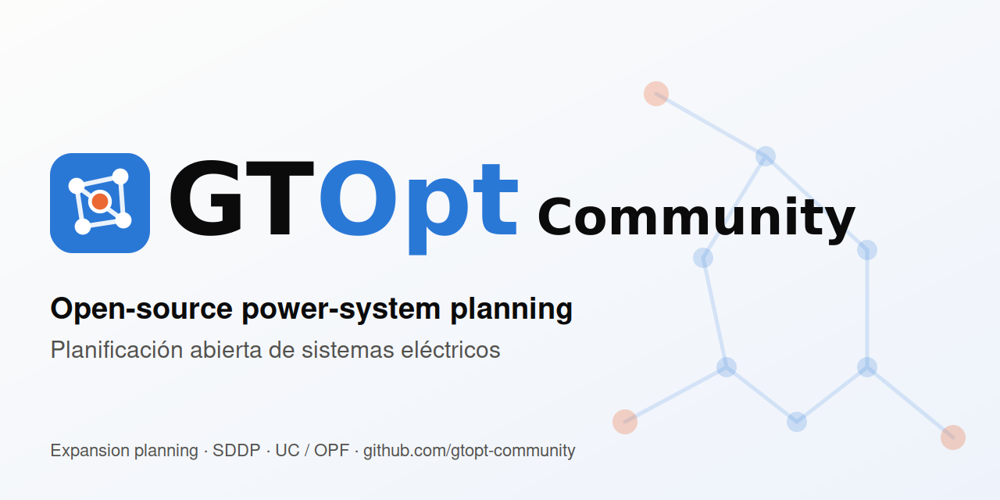

# GTOpt Community

**GTOpt** is an open-source optimizer for **planning and operating
energy systems**: generation, transmission, storage and demand expansion,
hydrothermal scheduling with SDDP, and unit commitment and dispatch. It
builds sparse LP/MIP models in C++ and solves them with the solver of
your choice (HiGHS, CBC/CLP, SCIP, cuOpt, CPLEX, Gurobi, MindOpt).

### One consistent model, from minutes to decades

The same formulation of electricity, water, fuels and LNG, hydrogen,
ammonia and heat is used from **daily operation** (15-minute to hourly
blocks) through the **medium term** (months to years, SDDP) to
**expansion planning** (decades). The scales are coupled through SDDP
optimality cuts (water values, storage opportunity costs) and
feasibility cuts (reservoir levels, water rights), so results agree
across horizons.

### Highlights

- **National scale**: built and validated on the Chilean national system
  (SEN), with its network, hydro cascades and irrigation agreements.
- **Storage and water values**: reservoirs, cascades, pumped hydro and
  batteries, with water values and opportunity costs per block.
- **Emissions**: CO₂-eq and local pollutants, caps and prices by zone,
  marginal emission factors per bus and hour, and the CO₂ impact of
  storage.
- **Constraints without code**: PAMPL, an AMPL-like language for
  operating rules such as irrigation agreements.
- **Open and auditable**: published formulation, exportable LP files, LP
  fingerprints, and JSON + Parquet data readable by any tool.
- **Interoperable**: converters from PLP, PLEXOS, PSR SDDP, PSS/E,
  pandapower and more.
- **From laptop to server and GPU**, with careful memory use.
- **Next**: offer-based electricity markets (energy and ancillary
  services, capacity, transmission rights).

### Repositories

We are starting with **[gtopt](https://github.com/gtopt-community/gtopt)**,
the optimization core for operating and investing in energy systems. More
modules are on the way:

| Repository | What it is | Status |
|---|---|---|
| [gtopt](https://github.com/gtopt-community/gtopt) | Optimization core for the operation and expansion of energy systems: solver, Python tools, browser GUI and web service | Available |
| gtopt-obs-cl | Observatory of the Chilean electricity market: tools to observe, reproduce and analyse the daily dispatch of the SEN | Coming soon |
| gtopt-bidmark | Bid-based market platform | Coming soon |
| gtopt-latam | Short- and long-term cases for the countries of the region | Coming soon |

These modules, and others developed together with the user community,
will be published in this organization.

### Get started

- [README and quick start](https://github.com/gtopt-community/gtopt#quick-start)
- [Documentation](https://gtopt-community.github.io/gtopt/)
- [Questions and ideas: Discussions](https://github.com/gtopt-community/gtopt/discussions)
- [Contributing](https://github.com/gtopt-community/gtopt/blob/master/CONTRIBUTING.md)
  (a CLA is required for pull requests)
- [Licensing](https://github.com/gtopt-community/gtopt/blob/master/LICENSING.md):
  AGPL-3.0-or-later with a solver plugin exception, or a commercial
  licence; the Extension SDK is Apache-2.0
- **[White paper](https://github.com/gtopt-community/gtopt/blob/master/docs/white_paper/main.pdf)**:
  *GTOpt: Open-Source Energy-System Optimization, Consistent from
  Minutes to Decades* (preprint, 2026): formulation, methods,
  multi-scale coupling, validation and the comparison with the Chilean
  daily schedule
- [Publications](https://github.com/gtopt-community/gtopt/blob/master/PUBLICATIONS.md):
  the white paper, the FESOP paper
  ([IEEE KPEC 2022](https://doi.org/10.1109/KPEC54747.2022.9814781))
  and related work
- [Who uses GTOpt](https://github.com/gtopt-community/gtopt/blob/master/USERS.md):
  add your organization or group
- [Friends and collaborators](https://github.com/gtopt-community/gtopt/blob/master/FRIENDS.md)
- [Service providers](https://github.com/gtopt-community/gtopt/blob/master/PROVIDERS.md):
  maintenance and development of GTOpt, and energy studies and
  consulting, by
  [Black Bear Engineering SpA](https://www.blackbeareng.cl)

---

### En español

**GTOpt** es un optimizador abierto para **planificar y operar sistemas
energéticos**, desarrollado en Chile: expansión de generación,
transmisión, almacenamiento y demanda; programación hidrotérmica con
SDDP; y predespacho y despacho.

- **Un mismo modelo, de minutos a décadas**: la operación diaria
  (bloques de 15 minutos a una hora), el mediano plazo (meses a años) y
  la planificación (décadas) usan la misma formulación de electricidad,
  agua, combustibles y GNL, hidrógeno, amoníaco y calor, acoplados con
  cortes de optimalidad y factibilidad de SDDP.
- **Escala nacional**: probado en el SEN, con su red, cuencas y
  convenios de riego (Maule, Laja).
- **Valores del agua y costos de oportunidad** de embalses y baterías.
- **Emisiones** de CO₂ y contaminantes locales, factores marginales por
  barra y hora, e impacto del almacenamiento en la reducción de CO₂.
- **Abierto y auditable**: formulación publicada, LP exportable y datos
  en JSON y Parquet.
- **Próximo paso**: mercados con ofertas (energía y servicios
  complementarios, suficiencia, derechos de transmisión).

**Repositorios.** Partimos con
**[gtopt](https://github.com/gtopt-community/gtopt)**, el núcleo de
optimización de la operación e inversión de sistemas energéticos. Pronto
vienen:

- **gtopt-obs-cl**: el observatorio del mercado eléctrico chileno, con
  herramientas para observar, reproducir y analizar el despacho diario
  del SEN.
- **gtopt-bidmark**: plataforma de mercado de ofertas.
- **gtopt-latam**: casos de corto y largo plazo de los países de la
  región.

Estos módulos, y otros que se desarrollen con la comunidad de usuarios,
se incorporarán en esta organización.

**White paper.** La referencia del proyecto es
[*GTOpt: Open-Source Energy-System Optimization, Consistent from Minutes
to Decades*](https://github.com/gtopt-community/gtopt/blob/master/docs/white_paper/main.pdf)
(preprint, 2026), con la formulación, los métodos, la validación y la
comparación con el programa diario del CEN. Más publicaciones en
[PUBLICATIONS.md](https://github.com/gtopt-community/gtopt/blob/master/PUBLICATIONS.md).

¿Usas GTOpt? Agrega tu organización o grupo en
[USERS.md](https://github.com/gtopt-community/gtopt/blob/master/USERS.md). Los amigos y colaboradores del
proyecto están en
[FRIENDS.md](https://github.com/gtopt-community/gtopt/blob/master/FRIENDS.md),
y los servicios de mantenimiento y desarrollo de GTOpt, y de estudios
y consultorías en energía, de
[Black Bear Engineering](https://www.blackbeareng.cl), en
[PROVIDERS.md](https://github.com/gtopt-community/gtopt/blob/master/PROVIDERS.md).

Las contribuciones son bienvenidas; las preguntas pueden hacerse en
español en
[Discussions](https://github.com/gtopt-community/gtopt/discussions).
